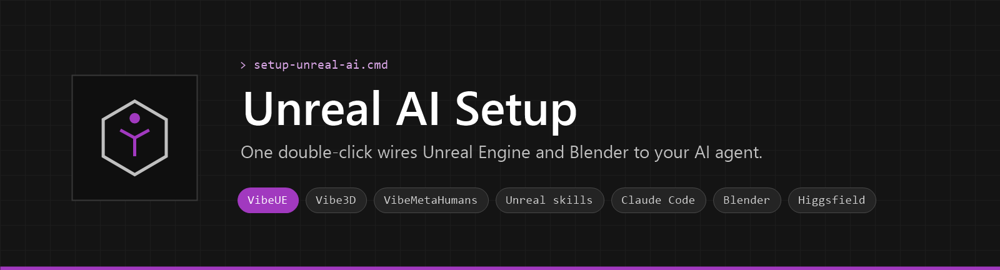
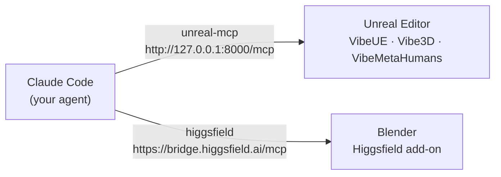
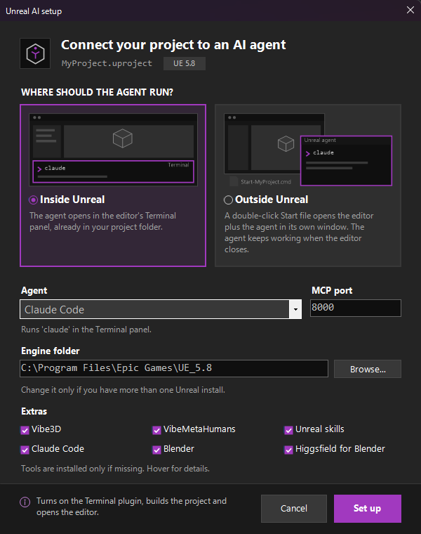

<p align="center"></p>

<p align="center">
  
  
  
  
  
  
</p>

<p align="center">
  <b>Make a new Unreal project. Double-click one file. Start talking to your agent.</b><br>
  <a href="#quick-start">Quick start</a> ·
  <a href="#what-you-get">What you get</a> ·
  <a href="#how-it-connects">How it connects</a> ·
  <a href="#command-line-options">Options</a> ·
  <a href="#troubleshooting">Troubleshooting</a>
</p>

---

Unreal AI Setup turns a freshly created Unreal Engine 5.8 (or 5.7) project into one your AI agent can
drive through MCP. It clones the [VibeUE](https://github.com/kevinpbuckley/VibeUE) plugin, enables the
engine's MCP plugins, writes the MCP server and client settings, builds the plugin and opens the editor.
That replaces about ten manual steps (clone plugin, enable plugins, editor preferences, console
commands, build, git) with one double-click. With the extras, the same agent can drive Blender too.

> [!NOTE]
> **Renamed:** this project used to be `unreal-mcp-setup`, with the scripts `setup-vibeue.cmd` and
> `setup-vibeue.sh`. Old links redirect here. If you copied the old scripts into a project, replace
> them with `setup-unreal-ai.cmd` and `setup-unreal-ai.sh` and run the setup again.

## What you get

VibeUE is always installed. The six extras are ticked by default, and you can untick any of them.

| | Tool | What it gives you | What the setup does |
|---|---|---|---|
| **Core** | [VibeUE](https://github.com/kevinpbuckley/VibeUE) | Your agent drives the Unreal editor through MCP | Clones it, enables Unreal's MCP, writes your agent's MCP config, builds and opens the editor |
| **Unreal** | [Vibe3D](https://github.com/kevinpbuckley/Vibe3D) | Procedural 3D modeling: Modeling Mode's operators, from primitives and booleans to UVs, baking, rigging, collision and LODs. UE 5.8 | Clones it into `Plugins/` and enables it |
| | [VibeMetaHumans](https://github.com/kevinpbuckley/VibeMetaHumans) | Create, edit, rig and animate MetaHumans, and drive Live Link. UE 5.8, beta | Clones it into `Plugins/` and enables it for the editor |
| | [Unreal skills](https://github.com/kevinpbuckley/unreal-engine-skills) | About 70 skills of Unreal know-how (C++, Blueprints, gameplay, materials, Niagara, MetaHumans…) | Copies them into `.claude/skills` |
| **Tools** | Claude Code | The agent itself | Installs it, only if it is missing |
| | Blender | The free 3D suite | Installs the latest version, only if it is missing |
| | [Higgsfield for Blender](https://higgsfield.ai/plugins/blender) | Higgsfield's AI generation inside Blender, plus an MCP bridge so the agent can drive Blender | Installs and enables the add-on, turns on its MCP control and adds it to Claude Code |

## How it connects



The agent reaches an app only while that app is open. The Unreal MCP server listens only on your own
machine. The Higgsfield bridge goes through your Higgsfield account.

## Quick start

1. **Create a project** in Unreal Engine 5.8 (Blueprint or C++), then **close the editor**.
2. **Get the two scripts:** use **Code → Download ZIP** on this page, or
   `git clone https://github.com/JavorMin/unreal-ai-setup.git`. Copy `setup-unreal-ai.cmd` and
   `setup-unreal-ai.sh` into your project folder, next to the `.uproject` file.
   Don't save them one by one from the "Raw" view: that can give the `.cmd` file the wrong line endings.
3. **Double-click `setup-unreal-ai.cmd`**, check the values in the setup window and click **Set up**.
   The plugins are cloned and built, and the editor opens with the MCP server running.
4. **Start the agent:**
   - **Inside Unreal:** in the editor, open **Tools → Terminal**. Your agent starts in the project folder.
   - **Outside Unreal:** the agent window opens together with the editor. Next time, double-click
     `Start-<Project>` in the project folder.

Then try a first prompt such as *"What actors do I have selected?"* In Claude Code, `/mcp` should show
`unreal-mcp` as connected, and with the Higgsfield extra, `higgsfield` too.

> [!IMPORTANT]
> **Higgsfield needs two one-time sign-ins.** The script lists the ones that are still open at the end:
> - **Blender** opens by itself if you are not signed in yet. In the 3D viewport, press **N**, open the
>   **Higgsfield** tab and click **Sign in**. When you are signed in, the MCP section shows **Connected**.
> - **Claude Code:** run `/mcp`, pick `higgsfield` and choose **Authenticate**, with the same Higgsfield account.

## The setup window

<p align="center"></p>

| Field | Meaning |
|---|---|
| Where should the agent run? | **Inside Unreal:** the agent starts in the editor's Terminal panel, already in the project folder. **Outside Unreal:** a double-click `Start-<Project>` shortcut (with a purple Unreal icon) opens the editor and the agent in its own window, which keeps working while the editor is closed, for example during rebuilds. Click anywhere on a card to pick it |
| Agent | Claude Code, Cursor, VS Code, Gemini CLI, Codex, or All of them. The hint below it says what will start |
| MCP port | MCP server port. Default `8000` on 5.8, `8088` on 5.7 |
| Engine folder | Found automatically; change it or use **Browse...** if it is wrong |
| VibeUE API key | Only shown for 5.7. **Get a free key** opens [vibeue.com/login](https://www.vibeue.com/login): sign in with Google, copy your free key and paste it here |
| Extras | Untick what you don't want. Hover a box for what it does. Vibe3D and VibeMetaHumans need UE 5.8 |

Any time later, open a terminal in the project folder and run your agent (for example `claude`).
5.7 has no Terminal panel; the MCP connection is still set up.

## Requirements

- Windows 10 or 11
- Unreal Engine 5.8 (or 5.7) from the Epic Games Launcher or a source build
- [Git for Windows](https://git-scm.com/download/win). If it is missing, `setup-unreal-ai.cmd` offers to install it with `winget`.
- Visual Studio 2022 (17.8 or newer) or 2026 with C++ tools, Community or Build Tools. VibeUE ships as
  source code, so it must be compiled. If no C++ toolchain is found, the script offers to install
  Visual Studio 2022 Build Tools with `winget`.
- Internet access (the plugins are cloned from GitHub)
- Your agent's command-line tool if you want the script to start it for you. The Claude Code extra
  installs [Claude Code](https://docs.anthropic.com/en/docs/claude-code) for you.
- For the Higgsfield extra: a free [Higgsfield](https://higgsfield.ai) account, and Blender 5.1 or
  newer (the Blender extra installs the latest one if needed).

## What it changes

<details>
<summary><b>In your project</b></summary>

| File / folder | Change |
|---|---|
| `Plugins/VibeUE/` | VibeUE cloned from GitHub (branch `5-8` or `5-7`). Skipped if a VibeUE plugin is already in `Plugins/` |
| `Plugins/Vibe3D/`, `Plugins/VibeMetaHumans/` | Extras (5.8): cloned from GitHub (branch `main`). Skipped if already in `Plugins/` |
| `<Project>.uproject` | 5.8: enables `ModelContextProtocol`, `AllToolsets`, `EditorToolset`. `Terminal` is enabled inside Unreal and disabled outside. Extras: enables `Vibe3D` and `VibeMetaHumans` (editor only). Unticking an extra later leaves its entry alone |
| `Config/DefaultEditorPerProjectUserSettings.ini` | 5.8: MCP server auto-start on, port, path `/mcp`, tool search on. 5.7: VibeUE's own MCP server (`[VibeUE.MCPServer]` Enabled, Port) |
| `Saved/Config/WindowsEditor/EditorPerProjectUserSettings.ini` | 5.8, inside Unreal: Terminal startup commands: `set TERM=xterm-256color`, `cd /d "<project folder>"`, then `claude`, `gemini` or `codex` (no command for Cursor / VS Code). 5.7: the VibeUE API key, if you gave one |
| `Start-<Project>.cmd` | Outside Unreal: opens the editor, and a PowerShell window that waits for the MCP server and then starts `claude`, `gemini` or `codex` (a plain shell for Cursor / VS Code) |
| `Start-<Project>.lnk` + `Saved/VibeUE/Start.ico` | Outside Unreal: a shortcut to the `.cmd` with the `.uproject` icon recolored Unreal purple  (a `.cmd` file can't have its own icon) |
| `.mcp.json` + `.claude/settings.local.json` | Claude Code: server `unreal-mcp`, enabled without an approval prompt |
| `.cursor/mcp.json` | Cursor |
| `.vscode/mcp.json` | VS Code |
| `.gemini/settings.json` | Gemini CLI |
| `.codex/config.toml` | Codex. Only created if the file does not exist; otherwise the script prints the lines to add by hand |
| `CLAUDE.md` / `AGENTS.md` / `GEMINI.md` | VibeUE's agent guide, inside `<!-- BEGIN VibeUE … -->` / `<!-- END VibeUE -->` markers. Your own text in these files is kept |
| `.claude/skills/ue-*/` | Unreal skills extra: each skill from [unreal-engine-skills](https://github.com/kevinpbuckley/unreal-engine-skills) (5.8: branch `master`, 5.7: branch `5.7`). A skill that changed upstream replaces its folder; your own skills are left alone |
| `Saved/UnrealAI/unreal-engine-skills/` | Unreal skills extra: the cloned skills repo the skills are copied from (fetched again on each run) |
| `.gitignore` | Unreal's standard ignores plus the cloned folders (`/Plugins/VibeUE/`, the extras' plugins, the Unreal skills) |
| `.git` | `git init` and an initial commit, only if the folder is not a git repo with commits yet |

All MCP client configs point to `http://127.0.0.1:<port>/mcp` with the server name `unreal-mcp`.
Existing JSON config files are merged, not replaced. Then the script builds the project with the
engine's `Build.bat` and launches the editor.

The Terminal startup commands and the Start icon go in `Saved/` because they depend on the absolute
path of the project folder, which is different on each machine. For the same reason the Start
shortcut only works on the machine that ran the setup; `Start-<Project>.cmd` works anywhere.

</details>

<details>
<summary><b>On your PC (the tool extras)</b></summary>

| Extra | Change |
|---|---|
| Claude Code | If `claude` is missing: Anthropic's installer (`irm https://claude.ai/install.ps1 \| iex`) puts it in `%USERPROFILE%\.local\bin`, which is added to your user `PATH` |
| Blender | If there is no Blender (or, with Higgsfield, none at 5.1 or newer): `winget install BlenderFoundation.Blender` |
| Higgsfield for Blender | Downloads the add-on from Higgsfield's update feed (checked against its sha256) unless that version is already installed, installs and enables it in Blender, and turns on its **Enable MCP control** preference (Blender user preferences). Adds the `higgsfield` server (`https://bridge.higgsfield.ai/mcp`, user scope) to Claude Code with `claude mcp add` |

</details>

## Command-line options

`setup-unreal-ai.cmd` and `bash setup-unreal-ai.sh` accept the same options:

| Option | Meaning |
|---|---|
| `--agent X` | `ClaudeCode`, `Cursor`, `VSCode`, `Gemini`, `Codex` or `All` |
| `--port N` | MCP server port |
| `--engine DIR` | Engine folder (also read from the `UE_ENGINE_PATH` environment variable) |
| `--api-key KEY` | VibeUE API key (5.7) |
| `--internal` | Agent runs inside Unreal (editor Terminal panel) |
| `--external` | Agent runs outside Unreal (`Start-<Project>` shortcut) |
| `--extras LIST` | Which extras to set up: `all` (the default), `none`, or a comma list of `vibe3d`, `metahumans`, `skills`, `claude`, `blender`, `higgsfield` |
| `--no-gui` | No setup window: use the options given, and ask in the console for the rest (the default for where the agent runs is inside) |
| `--no-build` | Only write the configuration; do not build or launch |
| `path\to\Project.uproject` | Use this project instead of the one next to the script |

```
setup-unreal-ai.cmd --no-gui --agent ClaudeCode --port 8000 --external
setup-unreal-ai.cmd --no-gui --extras skills,higgsfield
```

The engine is found in this order: `--engine` / `UE_ENGINE_PATH`, the Windows registry (source builds
and launcher installs), then the Epic Games Launcher's install list.

## Re-running

> [!TIP]
> The script is safe to run again. Every file edit is an update-in-place, so a re-run with the same
> choices changes nothing.

Re-run it to:

- change the agent or the port,
- switch between inside and outside Unreal (switching to inside leaves the old `Start-<Project>`
  files in place; delete them if you don't need them),
- update the Terminal startup path or the Start shortcut after you move the project folder,
- set up the project on another machine or after a fresh clone (the plugin folders and Unreal skills
  are git-ignored, so they are fetched again),
- update the Unreal skills and the Higgsfield add-on to their latest versions.

## Troubleshooting

| Problem | Fix |
|---|---|
| Build failed | Close this project's editor and run the script again. With a source-built engine, close every editor of that engine (Live Coding blocks builds). The error message shows the path of the Unreal Build Tool log |
| Build log says "An Application Control policy has blocked this file" | Windows Smart App Control blocks the DLLs that Unreal Build Tool compiles while it builds. Unreal can't build C++ plugins while it is on: turn it off in Windows Security → App & browser control → Smart App Control (Windows can't turn it back on without a reinstall), or build on another PC |
| Build fails in VibeMetaHumans | It is a new beta. Remove its entry from the `.uproject`, then re-run without it: untick it, or pass `--extras` without `metahumans` |
| Engine not found | Pass the engine folder: `setup-unreal-ai.cmd --engine "C:\Program Files\Epic Games\UE_5.8"` |
| "not a valid Unreal project name" | Rename the `.uproject`: it must start with a letter and contain only letters, digits and `_` (no spaces) |
| "skipped the initial commit" | Set your git identity, then run the script again: `git config --global user.name "Your Name"` and `git config --global user.email "you@example.com"` |
| Setup window does not appear or misbehaves | Use `--no-gui` |
| Agent does not start (Terminal panel or agent window) | Install its CLI (the script prints a note if `claude`, `gemini` or `codex` is not on `PATH`), or tick the Claude Code extra |
| No `Start-<Project>` shortcut, only the `.cmd` | Creating the icon failed (the script prints why). The `.cmd` does the same job; double-click it instead |
| Start shortcut stopped working | You moved the project folder or cleaned `Saved/`. Run the setup again |
| Higgsfield MCP shows "Not connected" in Blender | Sign in: press **N** in the 3D viewport, open the **Higgsfield** tab and click **Sign in**. Keep Blender open while the agent uses it |
| `/mcp` shows `higgsfield` needs authentication | In Claude Code, run `/mcp`, pick `higgsfield`, choose **Authenticate** and sign in with your Higgsfield account |
| "Higgsfield for Blender needs Blender 5.1 or newer" | Tick the Blender extra (or install Blender 5.1+ yourself) and run the setup again |

## Good to know

> [!WARNING]
> **The Unreal MCP server listens only on your own machine (127.0.0.1) and has no authentication.**
> This is how Epic designed it. The Higgsfield add-on's **Enable MCP control** lets connected AI
> clients run Python in your Blender session.

- **5.7 is legacy.** 5.7 has no engine MCP plugin, so VibeUE runs its own MCP server, and tool
  execution and AI Chat need a free VibeUE API key. The script stores the key under `Saved/`, which is
  git-ignored, so it never ends up in your project's commits. Keep it private: it is tied to your
  vibeue.com account.
- **Don't commit `Saved/`.** It holds machine-specific settings; the script adds it to `.gitignore`.
- Paths with spaces and non-ASCII characters work. The scripts also work if Git checks them out
  with CRLF line endings.
- The setup window uses Unreal Editor's dark theme. It is drawn at fixed pixel sizes, so on displays
  scaled above 100% Windows enlarges it and it looks slightly soft.
- Not yet verified: clicking through the setup window by hand (use `--no-gui` if it misbehaves),
  building Vibe3D and VibeMetaHumans (the test PC had Smart App Control on), installing Claude Code
  and Blender on a PC that lacks them, and macOS / Linux (the configuration steps may run, but build,
  launch and the tool extras are Windows-only).

## Credits

- [VibeUE](https://github.com/kevinpbuckley/VibeUE), [Vibe3D](https://github.com/kevinpbuckley/Vibe3D),
  [VibeMetaHumans](https://github.com/kevinpbuckley/VibeMetaHumans) and
  [unreal-engine-skills](https://github.com/kevinpbuckley/unreal-engine-skills) by Kevin Buckley.
- [Higgsfield for Blender](https://higgsfield.ai/plugins/blender) by Higgsfield.
- Unreal MCP setup follows Epic's documentation:
  [Unreal MCP in the Unreal Editor](https://dev.epicgames.com/documentation/unreal-engine/unreal-mcp-in-unreal-editor).

Unreal Engine is a trademark of Epic Games; this project is not affiliated with Epic Games, VibeUE,
Higgsfield, the Blender Foundation or Anthropic.

## License

[Apache License 2.0](LICENSE)
